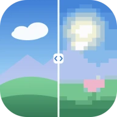
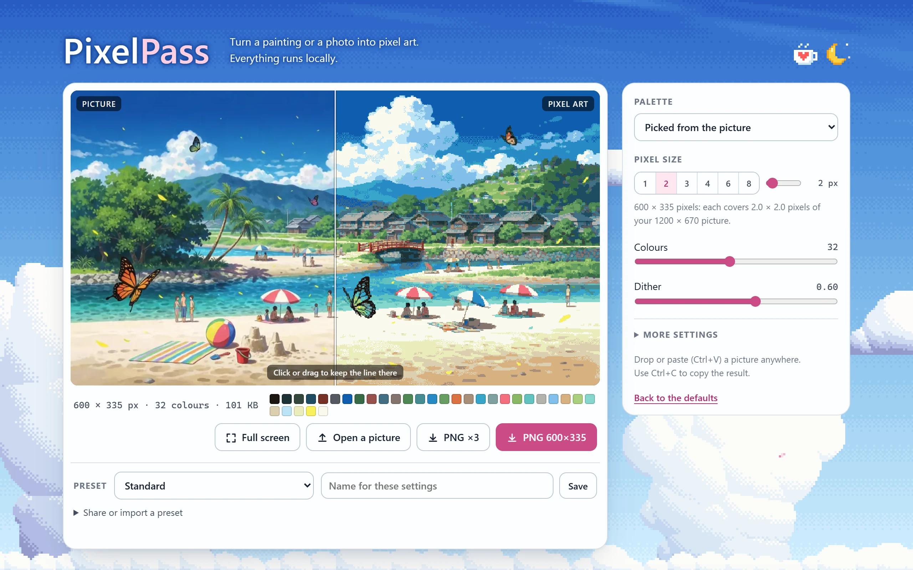

<div align="center">



# Pixel Pass

**Turn a painting or a photo into pixel art, right in your browser.**

[](https://pixelpass.iromoto.dev)


[](LICENSE)

<picture>
  <source media="(prefers-color-scheme: dark)" srcset="docs/screenshot-night.webp">
  
</picture>

</div>

**Everything runs locally:** your picture is never uploaded, the page makes no network requests and uses no cookies or
trackers.

**Use it:** [pixelpass.iromoto.dev](https://pixelpass.iromoto.dev) · or download `index.html` and open it, it works offline.

## Features

- Pixel size 1–16, palette from the picture or a classic one (PICO-8, Game Boy, C64, …)
- Dither only on smooth areas, edges stay clean
- Before/after slider, presets, PNG export with transparency
- One HTML file, no dependencies, works offline

## How it works

OKLab block reduction → k-means palette → Bayer dither on smooth areas → speck cleanup.

## Build

The source is `src/pixel-pass.html` (plain HTML, CSS and JavaScript, no dependencies). `build.py` embeds the sample
picture and writes the single-file `index.html`:

```sh
python build.py
```

## Credits

- Palettes: DawnBringer 32 by DawnBringer, Endesga 32 by ENDESGA, Sweetie 16 by GrafxKid, PICO-8 by Lexaloffle,
  Commodore 64 colours after Philip "Pepto" Timmermann, Game Boy's original four greens.
- Sample picture: part of the demo only. It is not covered by the GPL and may not be used on its own;
  replace `src/sample.webp` with your own picture if you build on this project.
- Icon and screenshots in `docs/`: not covered by the GPL either (the screenshots show the sample picture).

## License

Copyright (C) 2026 iromoto

Pixel Pass is free software: you can redistribute it and/or modify it under the terms of the GNU General Public
License as published by the Free Software Foundation, either version 3 of the License, or (at your option) any later
version (GPL-3.0-or-later). See [LICENSE](LICENSE). The sample picture, the icon and the screenshots are excluded
(see Credits).
